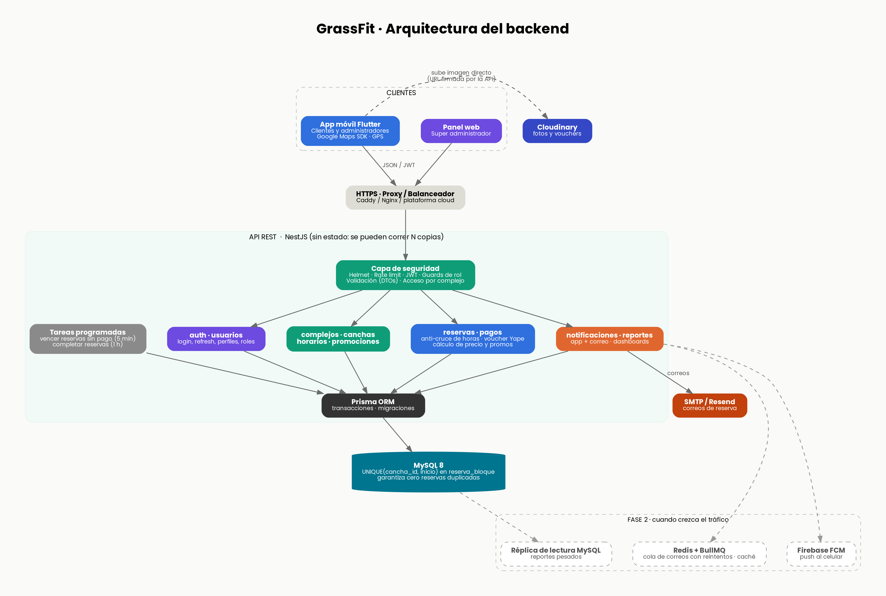
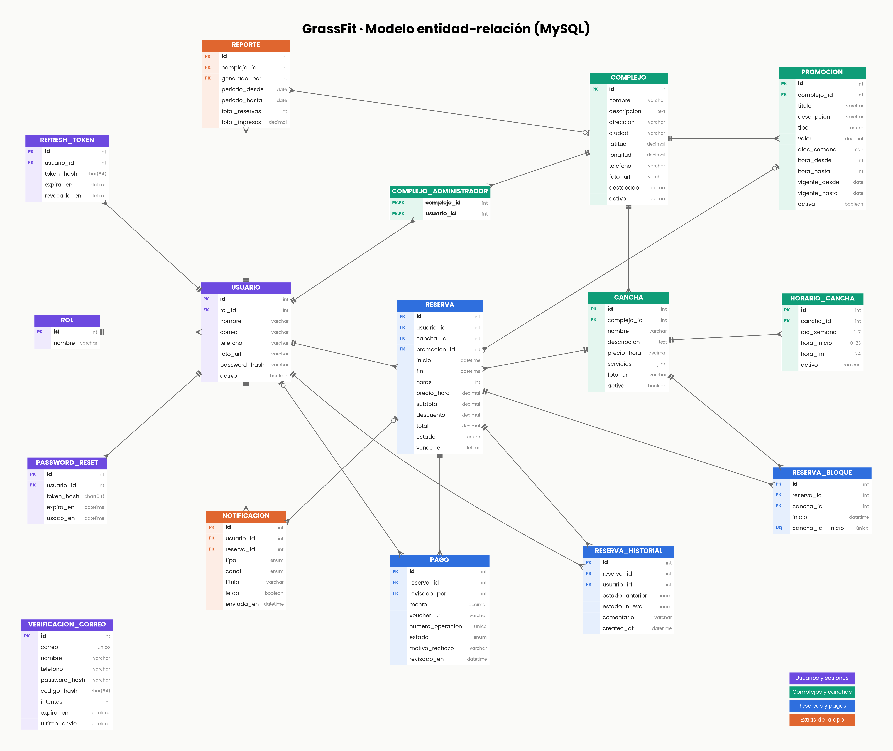

# GrassFit · Backend

API REST para la app móvil (Flutter: clientes y administradores) y el panel web del super administrador.
**Stack:** Node.js 20 · NestJS 10 · Prisma 5 · MySQL 8 · Cloudinary · JWT.




## 1. Cómo levantarlo

```bash
cp .env.example .env            # (Windows CMD: copy .env.example .env) y edita JWT_SECRET
npm install
docker compose up -d mysql      # MySQL local
npx prisma migrate dev --name init
npm run seed                    # crea roles y el super admin (SUPERADMIN_EMAIL / SUPERADMIN_PASSWORD)
npm run start:dev
```

- API: `http://localhost:3000/api/v1` · Documentación Swagger: `http://localhost:3000/docs`
- Salud: `GET /api/v1/health`
- Pruebas: `npm test`
- Postman: importa `postman/GrassFit.postman_collection.json` (guarda tokens e ids solo)
- Producción con Docker: `docker compose --profile full up --build`

> Los correos, si `SMTP_HOST` está vacío, solo se muestran en consola (útil en desarrollo).

## 2. Estructura

```
prisma/schema.prisma        Modelo de datos (16 tablas) + seed.ts
src/
  common/                   guards (JWT, roles), decorators, utilidades (hora Perú, precios, geo), AccesoService
  auth/                     registro con verificación de correo, login, refresh con rotación, logout
  usuarios/                 perfil propio + gestión de usuarios (super admin)
  complejos/                listado (cercanía, destacados), detalle, administradores del complejo
  canchas/                  CRUD, horarios semanales, disponibilidad por fecha
  promociones/              porcentaje, monto fijo, 2x1 (por día y franja horaria)
  reservas/                 crear (anti-cruce), listar, cancelar, rechazar, tareas programadas
  pagos/                    voucher Yape: subir, verificar, rechazar
  notificaciones/           notificaciones en la app + correo
  storage/                  subida de imágenes a Cloudinary (reemplaza la anterior y borra la vieja)
  reportes/                 dashboards admin / super admin
```

Cada carpeta es un módulo independiente (controller → service → Prisma). Si algún día un módulo
crece demasiado, se puede separar a su propio servicio sin reescribir el resto.

## 3. Roles y permisos

| Rol | Puede |
|---|---|
| `usuario` | ver complejos/canchas, reservar, subir voucher, cancelar, ver sus reservas y notificaciones |
| `administrador` | todo lo anterior + gestionar **solo los complejos que tiene asignados**: canchas, horarios, promociones, revisar vouchers, ver reservas y reportes |
| `super_admin` | todo, en todos los complejos; crea usuarios/administradores, asigna administradores a complejos y marca complejos como `destacado` |

La regla "el administrador solo toca sus complejos" vive en un único lugar: `AccesoService`.

## 4. Endpoints (prefijo `/api/v1`)

| Método | Ruta | Quién | Descripción |
|---|---|---|---|
| POST | `/auth/register` | público | **Paso 1:** valida datos y envía código de 6 dígitos al correo (el usuario aún NO se crea) |
| POST | `/auth/verificar-registro` | público | **Paso 2:** con el código correcto se crea el usuario y se inicia sesión |
| POST | `/auth/reenviar-codigo` | público | Nuevo código (espera de 60 s entre envíos) |
| POST | `/auth/recuperar/solicitar` | público | **Recuperar contraseña, paso 1:** envía un código de 6 dígitos al correo (responde igual exista o no la cuenta) |
| POST | `/auth/recuperar/verificar` | público | **Paso 2 (opcional):** comprueba el código para mostrar la pantalla de nueva contraseña |
| POST | `/auth/recuperar/restablecer` | público | **Paso 3:** código + `nuevaPassword`; cierra todas las sesiones y avisa por correo |
| POST | `/auth/login` `/auth/refresh` `/auth/logout` | público | Sesión (access 15 min + refresh 30 días con rotación) |
| GET | `/usuarios/me` | autenticado | Perfil |
| PATCH | `/usuarios/me` | autenticado | **form-data**: `nombre`, `telefono`, `foto` (archivo). La foto nueva reemplaza la anterior |
| GET/POST/PATCH | `/usuarios` , `/usuarios/:id` | super_admin | Listar, crear y activar/desactivar usuarios |
| GET | `/complejos?destacado=&q=&lat=&lng=` | autenticado | Lista; con `lat/lng` ordena por cercanía (no se guardan) |
| GET | `/complejos/:id` | autenticado | Detalle con canchas y promociones vigentes |
| GET | `/complejos/mios` | admin, super | Complejos que administra |
| POST/PATCH | `/complejos` , `/complejos/:id` | super / admin del complejo | **form-data** con campos y `foto` (archivo, reemplaza la anterior) |
| GET/POST/DELETE | `/complejos/:id/administradores` | super_admin | Asignar administradores |
| GET | `/canchas?complejoId=` , `/canchas/:id` | autenticado | Listado y detalle (con horarios) |
| GET | `/canchas/:id/disponibilidad?fecha=YYYY-MM-DD` | autenticado | Horas libres de ese día |
| GET | `/canchas/mias` | admin, super | Canchas de sus complejos |
| POST/PATCH | `/canchas` , `/canchas/:id` | admin del complejo | **form-data** con campos (precio por hora…) y `foto` (archivo) |
| PUT | `/canchas/:id/horarios` | admin del complejo | Guarda la plantilla semanal (pantalla "Horarios disponibles") |
| GET | `/promociones?complejoId=` | autenticado | Vigentes hoy |
| GET/POST/PATCH/DELETE | `/promociones/admin` , `/promociones` , `/promociones/:id` | admin del complejo | Gestión (DELETE = desactivar) |
| POST | `/reservas` | autenticado | Crear reserva (`canchaId`, `inicio`, `horas`, `promocionId?`) |
| GET | `/reservas/mias?estado=` | autenticado | Mis reservas (activas / historial) |
| GET | `/reservas/admin?complejoId=&estado=&fecha=` | admin, super | Reservas de sus complejos (con voucher) |
| GET | `/reservas/:id` | dueño o admin del complejo | Detalle + historial de estados |
| PATCH | `/reservas/:id/cancelar` | dueño | Cancela (hasta N horas antes) |
| PATCH | `/reservas/:id/rechazar` | admin del complejo | Rechaza y libera el horario |
| POST | `/reservas/:id/voucher` | dueño | **form-data**: `voucher` (imagen) y `numeroOperacion` (opcional) |
| PATCH | `/pagos/:id/verificar` | admin del complejo | Voucher correcto → reserva **confirmada** |
| PATCH | `/pagos/:id/rechazar` | admin del complejo | Voucher incorrecto → el cliente puede subir otro |
| GET/PATCH | `/notificaciones` , `/notificaciones/:id/leida` , `/notificaciones/leer-todas` | autenticado | Bandeja de la app |
| GET/POST | `/reportes/resumen` , `/reportes/global` , `/reportes` | admin / super | Dashboards y reportes guardados |

## 5. Registro con verificación de correo

```
Cliente ── POST /auth/register ──────────► valida datos, guarda la solicitud "en espera" y envía el código (10 min de vigencia)
Cliente ── POST /auth/verificar-registro ► código correcto → se CREA el usuario y se inicia sesión
                                           código incorrecto → no se crea nada (máx. 5 intentos por código)
Cliente ── POST /auth/reenviar-codigo ───► código nuevo (cada 60 s)
```
El código nunca se guarda en claro (solo un HMAC) y la contraseña queda cifrada desde el primer paso.
Los usuarios que crea el super admin (`POST /usuarios`) no pasan por verificación.

## 6. Recuperar contraseña

```
Usuario ── POST /auth/recuperar/solicitar ───► código de 6 dígitos al correo (vence en 10 min; 1 envío por minuto)
Usuario ── POST /auth/recuperar/verificar ───► {valido:true}  (opcional; cada fallo suma un intento, máx. 5)
Usuario ── POST /auth/recuperar/restablecer ─► guarda la nueva contraseña, cierra TODAS las sesiones,
                                               borra el código y envía un aviso de seguridad por correo
```
- Responde lo mismo exista o no el correo, para no revelar qué cuentas existen.
- El código no se guarda en claro (HMAC) y un código de registro no sirve para recuperar contraseña.
- Si el correo no se puede enviar y no hay SMTP configurado en desarrollo, el código aparece en la consola del servidor.

## 7. Flujo de una reserva con Yape

```
Usuario ── POST /reservas ─────────────► reserva PENDIENTE (reserva las horas, vence en 30 min)
        ◄─ correo "Reserva registrada"
Usuario ── POST /reservas/:id/voucher ──► (form-data con la imagen) la API la sube a Cloudinary → pago PENDIENTE
                                           (la reserva ya no vence)  → aviso al admin
Admin   ── PATCH /pagos/:id/verificar ──► pago VERIFICADO + reserva CONFIRMADA
        ◄─ correo "Reserva confirmada"                       (usuario)
   o
Admin   ── PATCH /pagos/:id/rechazar ───► pago RECHAZADO; el usuario tiene 30 min para subir otro
        ◄─ correo "Voucher rechazado"                        (si no lo hace, se libera el horario)
```

## 8. Decisiones importantes (y por qué)

1. **No se pueden duplicar reservas, ni con fallos de código.** Cada hora reservada es una fila en
   `reserva_bloque` con `UNIQUE(cancha_id, inicio)`. Si dos personas reservan la misma hora a la vez,
   la base de datos rechaza a la segunda (el API responde 409).
2. **Reservas sin pago no bloquean horarios para siempre.** `reserva.vence_en` (30 min) + una tarea
   programada cada 5 minutos libera las horas. Mientras el admin revisa un voucher, la reserva no vence.
3. **Precio congelado.** La reserva guarda `precio_hora`, `subtotal`, `descuento` y `total`; si el
   admin cambia el precio de la cancha, las reservas ya hechas no cambian. El descuento solo cuenta las
   horas que cubre la promoción (ej. "10% de 14:00 a 18:00" no descuenta la hora de las 19:00).
4. **Horas en UTC en la BD, hora de Perú (UTC-5) en la lógica.** Perú no usa horario de verano, así que
   un desfase fijo es correcto y evita dependencias. `horario_cancha` usa horas enteras (0-24).
5. **El administrador solo ve sus complejos**, y solo el super admin puede marcar `destacado`
   (si no, cada complejo se marcaría a sí mismo).
6. **Ubicación del usuario: no se guarda.** La app manda `lat/lng` solo para ordenar por cercanía;
   la ruta la traza Google Maps en el celular hacia `complejo.latitud/longitud`.
7. **Las imágenes se envían como archivo (form-data) a la API**, que las sube a Cloudinary (máx. 5 MB, JPG/PNG/WEBP,
   reducidas a 1200 px). Al reemplazar una foto se borra la anterior; si falla el guardado, se borra la nueva.
8. **Refresh tokens con rotación**: si alguien reutiliza un token viejo, se cierran todas las sesiones.

## 9. Escalabilidad: qué hacer y cuándo

| Etapa | Qué | Cómo |
|---|---|---|
| Hoy | 1 servidor + MySQL | Ya soporta cientos de usuarios concurrentes. La API **no guarda estado**: se pueden correr varias copias detrás de un balanceador. |
| Más tráfico | Varias copias de la API | Cuidado: las tareas programadas correrán en cada copia (son idempotentes, pero conviene dejarlas en una sola: pon `RUN_CRONS=false` en todas las copias menos una). |
| Correos lentos o fallidos | Redis + BullMQ | `NotificacionesService` ya aísla el envío; se cambia por una cola con reintentos. La tabla `notificacion` ya registra `enviada_en`. |
| Push al celular | Firebase FCM | Agregar tabla `dispositivo` (token FCM por usuario). |
| Reportes pesados | Réplica de lectura / caché | Los reportes ya son consultas agregadas, fáciles de mover a una réplica. |
| Muchos complejos | Búsqueda por cercanía en SQL | Hoy se calcula en memoria (ideal hasta unos cientos de complejos); luego, índice espacial de MySQL. |

## 10. Pendiente (fase 2)

- Cambiar contraseña estando con sesión iniciada (pidiendo la actual).
- Bloqueos de horario por mantenimiento/feriado.
- Tarjeta Visa y efectivo (hoy solo Yape).
- Vouchers con acceso privado en Cloudinary (hoy las URLs no son adivinables, pero son públicas).
- Pruebas de integración de los flujos de reserva y pago.
